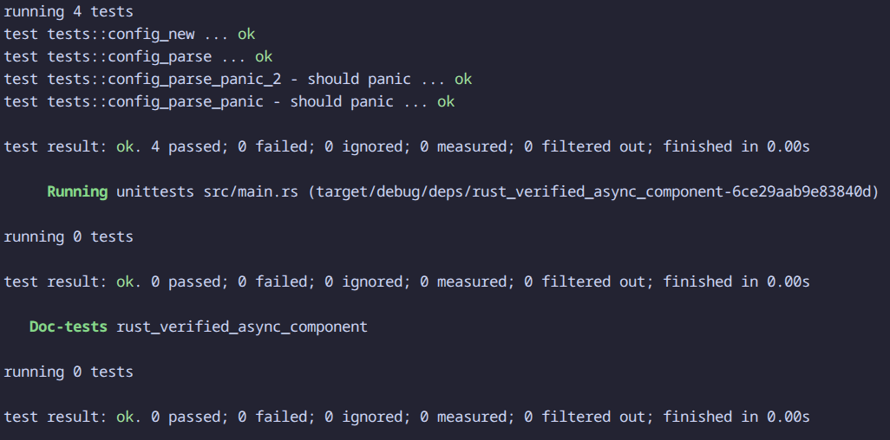
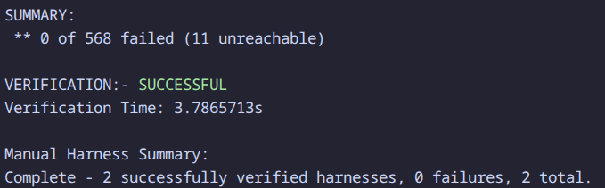

# Rust Verified Async Component
A program that simulates the behavior of a possible actor implemented in Rust.\
For the full verification strategy, tool-selection rationale, and comparative analysis, see the [Verification Report](REPORT.md).\
The actor is implemented as a small finite state machine (FSM); its behavior depends heavily on the state in order to avoid dangerous actions.\
It is also possible to simulate an example of how different amounts of actors will act on a determined amount of shared resources.\
All the configuration parameters are set by the arguments of the program. In particular:
- The first argument is the number of actors                                                            (default: 1)
- The second is the number of retries to access the shared resource an actor performs before failing    (default: 5)
- The third is the number of seconds the actor waits before retrying                                    (default: 1)
- The fourth is the number of shared resources                                                          (default: 1)
- The fifth is the amount of seconds the actor needs to perform its action                              (default: 3)

If any argument is missing, the default value is used.\
Some assumptions I made are that an actor whose integrity has been checked can't be compromised and that a broken actor cannot be repaired.\
## Building and running

### Multi-actor simulation (4 actors, 5 retries, 1s wait, 2 resources, 3s work):
```bash
cargo run -- 4 5 1 2 3
```
### Interactive single-actor mode (no arguments):
```bash
cargo run
```
### Native tests:
```bash
cargo test
```
### Kani verification:
```bash
cargo kani
```
### Creusot verification (from project root):
```bash
cargo creusot
```
## Main
The `main` function has two modes. If there are arguments when the program is launched it just takes the arguments used to launch the program, initializes the configs and then calls the [`run`](#run) function. If there are no arguments it instead calls the [`direct_simulation`](#direct_simulation) function.
## Config
The `Config` struct, in the lib file, has five fields, one for each possible argument. The `new` function takes all five arguments and returns the correct `Config`.
### parse
The `parse` method takes a vector of Strings as argument, then initializes a vector with the default values.\
This last vector gets modified with the arguments taken as number and in the end it returns a new `Config` struct with the new values; if it's not possible or too many arguments are passed, the method returns an Err instead.
## run
The `run` function is the main example of how a chosen number of actors can act using a certain chosen number of shared resources.\
It generates the shared resources locked with a Mutex to avoid race conditions then it creates the async block and the vector that waits for the futures returned by the actors.\
It spawns the designated number of actors and for each of them adds the corresponding future to the vector. \
After the last actor is spawned it waits for each future and handles every error returned either printing the reason the actor did not act or by raising the same error again if the error is not recognized. Before returning it also asserts that the number of shared resources is the expected one.
## direct_simulation
The `direct_simulation` function allows the user to directly control an actor via the terminal, simulating its behaviour. It prints the current state of the actor and lets the user choose what to do next, reporting if the action is not allowed. The options are:
- 1 - let the user check the integrity of the actor and is required before making it act;
- 2 - makes the actor start its work;
- 3 - makes the actor stop;
- 4 - discard the new actor and create a new one (required if the actor is broken);
- 5 - make the program exit.

Any other input is ignored, prompting the user to try again.
## State
The `State` trait is what makes the actor actually work as a FSM. Each state is represented as a struct that implements this trait and the transitions are represented as the methods.\
The methods required are:
- `act`,
- `stop`,
- `check_integrity`,
- `to_string`,

### Idle
Represents an actor that has not been initialized yet. Its methods are:
- `check`, an additional method for the Idle state that ensures the integrity of the actor and returns true if the check is passed or false otherwise. At the moment for the example it only returns true;
- `act`, returns Err since a non-initialized actor cannot act (to ensure safety the integrity of the actor must first be proven);
- `stop`, returns Err since it is not acting;
- `check_integrity`, calls the check method and depending on what is returned it either returns the [`Initialized`](#initialized) state or the [`Broken`](#broken) state;
- `to_string`, returns a `String` containing `"Idle"`;

### Initialized
Represents an actor that is initialized and is waiting for the instruction to act. Its methods are:
- `act`, returns Ok and the state [`Acting`](#acting);
- `stop`, returns Err since it is not acting yet;
- `check_integrity`, returns the same `Initialized` state (as my assumption that integrity can't be compromised once checked);
- `to_string`, returns a `String` containing `"Initialized"`;

### Acting 
Represents an actor while it's working. Its methods are:
- `act`, returns Err since the actor is already busy;
- `stop`, returns Ok together with the [`Initialized`](#initialized) state. The actor stops and waits to, eventually, start again.
- `check_integrity`, returns the same `Acting` state for the same reasons as the previous state;
- `to_string`, returns a `String` containing `"Acting"`;

### Broken
Represents an actor that can't guarantee safety or encountered an error while being initialized. Its methods are:
- `act`, returns Err since it can cause danger;
- `stop`, returns Err since it is not acting and can't possibly be;
- `check_integrity` returns the same `Broken` state (as my assumption that a broken actor can't be repaired);
- `to_string`, returns a `String` containing `"Broken"`;

### Typestate invariants
The following invariants are enforced at compile time by the typestate pattern. The [`State`](#state) trait is crate-private, so external code cannot introduce a new state or bypass the transition rules.

1. Integrity before action. `Idle::act()` returns `Err`. The only valid path to [`Acting`](#acting) is [`Idle`](#idle) → `check_integrity` → [`Initialized`](#initialized) → `act` → [`Acting`](#acting). An uninitialised actor cannot start work.
2. [`Broken`](#broken) is terminal (by assumption). No method on [`Broken`](#broken) returns any other state. Once broken, an actor is permanently disabled; there is no repair transition.
3. No double-start. `Acting::act()` returns `Err`. An actor already working cannot be re-issued the act command.
4. No spurious stop. `Idle::stop()` and `Initialized::stop()` return `Err`. Only an [`Acting`](#acting) actor can be stopped.
5. Integrity is stable (by assumption). `Initialized::check_integrity()` and `Acting::check_integrity()` both return the same state, reflecting the design assumption that integrity, once verified, cannot be compromised.

## Actor
The struct that represents the actor itself, it consists of an id and the [`State`](#state) the actor is in.\
Its methods mirror those of the [`State`](#state) trait and allow the actor to change state from outside the library (since the [`State`](#state) trait is crate-private).\
All methods that can fail also include a guard against the state being in an unexpected or corrupted configuration, a defensive check that should never trigger in correct usage but handles the case regardless.

### new
Takes an `id` String as an argument and returns an `Actor` with that id and the default state [`Idle`](#idle).
### to_string
Returns a `String` that contains the ID of the `Actor` and the current state.
### check_integrity
Simulates the integrity check for the `Actor`. It takes the current [`State`](#state) and performs its `check_integrity()` method. Does not return anything since the [`State`](#state) is changed in the `Actor` itself and the `check_integrity()` method can't raise errors.\
Required before the use of the `Actor` to guarantee the safety property.
### act
Simulates the command to make the `Actor` start its work. It takes the current [`State`](#state) and performs its `act()` method. If it returns `Ok` the [`State`](#state) is changed otherwise the `Err` is raised again.\
This works correctly only for [`Initialized`](#initialized) `Actors`.
### stop
Simulates the command to make the `Actor` stop its work. It takes the current [`State`](#state) and performs its `stop()` method. If it returns `Ok` the [`State`](#state) is correctly updated otherwise the `Err` gets raised again.\
This works correctly only for [`Acting`](#acting) `Actors`.
### reserve_resource
It takes as input the `shared_resource` Mutex and waits to access it. Then if there are still resources available it reserves one and frees the Mutex for the other `Actor`s returning true. If no resources are still available it still frees the Mutex but it returns false.
> [!CAUTION]
> It is very important that after the resource is reserved it gets freed after the actor stops, otherwise the other actors can't access it even if no actor is working.
### free_resource
It works in a similar way to the [`reserve_resource`](#reserve_resource) method. It takes the `shared_resource` Mutex as input and tries to access it. Then it frees a resource for other `Actor`s.
### run
Simulates a possible complete execution of an `Actor`.\
At first the `Actor` checks its integrity, then it tries to reserve a resource.\
If it can, it simulates the act by sleeping for the [`Config`](#config)'s duration (in the mean time other `Actor`s can perform whichever action they can since the simulation is asynchronous). After this time the `Actor` is stopped, the resource is freed and the duration for which the `Actor` has worked is printed; `Ok` is returned.\
Additionally if for any reason an error occurs while the resource is reserved it gets freed immediately and the error is raised again.\
If the resource is busy, the process waits for the duration specified in the [`Config`](#config) struct and retries as many times as specified in the [`Config`s](#config). If it still could not act then a special error is raised.

# Tests
All the tests I made for the functions and to verify that everything works as it should.

## Rust-native tests
These are the tests natively supported in Rust framework.\
They just check if both methods of the [`Config`](#config) struct work as intended. To be specific:
- The first test checks if the [`new`](#new) method returns what I expect;
- The second test checks if the same thing applies for the [`parse`](#parse) method;
- The third and fourth tests check if the [`parse`](#parse) method panics when it should.

These tests result in:\
\

## Kani
[Kani](https://github.com/model-checking/kani) 0.67.0
Kani helps test different values to verify that no unsafe condition can be met focusing, for example, on overflow or array bounds.\
In my case I did two different tests on the [`parse`](#parse) method of the [`Config`](#config) struct:
- The first test verifies that any `String` value that can be parsed as an unsigned number causes no panic and gets correctly parsed by the method;
- The second test verifies that any `String` value that ***cannot*** be parsed as an unsigned number causes a panic.


These tests result in:\
\

## Creusot
[Creusot](https://creusot.rs/) 0.14.0-dev
Creusot is a tool that verifies Rust functions against formal contracts (pre- and post-conditions), proving they hold for all inputs.\
In this project I used Creusot to verify both the [`new`](#new) and the [`parse`](#parse) method of the [`Config`](#config) struct so that all the outputs correspond exactly to what is expected.\
These three tests (one for [`new`](#new) and two for [`parse`](#parse)) all pass:\
\

