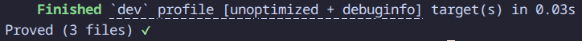

# Rust Verified Async Component
Program that simulate the behavior of a possible actor implemented in rust.\
The actor is implemented as a small finite state machine (FSM); its behavior depends heavily on the state in order to avoid dangerous actions.\
It is also possible to simulate an example of how diffent amount of actors will act on a determined amount of shared resources.\
All the configuration of the simulation are chosen with the arguments of the program. In particular:
- The first argument is the number of actors                                                            (default: 1)
- The second is the number of retries to access the shared resource an actor performs before failing    (default: 5)
- The third is the number of seconds the actor waits before retrying                                    (default: 1)
- The fourth is the number of shared resources                                                          (default: 1)
- The fifth is the amount of seconds the actor needs to perform its action                              (default: 3)

If any argument is missing the default value is used.\
Some assumptions I made are that an actor whose integrity has been checked can't be compromised and that a broken actor cannot be repaired.
## Main
The `main` function has two modes. If there are arguments when the program is launched it just takes the arguments used to launch the program, initialize the configs and then call the [`run`](#run) function. If there are no arguments it instead calls the [`direct_simulation`](#direct_simulation) function.
## Config
The `Config` struct, in the lib file, has five fields, one for each possible arguments. The `new` functions takes all five arguments and returns the correct `Config`
### parse
The `parse` method takes a vector of Strings as argument, then initialize a vector with the default values.\
This last vector gets modified with the arguments taken as number and in the end it returns a new `Config` struct with the new values; if it's not possible or too many arguments are passed, the method returns an Err instead.
## run
The `run` function is the main example of how a chosen number of actors can act using a certain chosen number of shared resource.\
It generates the shared resources locked with a Mutex to avoid race conditions then it creates the async block and the vector that waits for the futures returned by the actors.\
It spawns the designated number of actors and for each of them add the corresponding future to the vector. \
After the last actor is spawned it waits for each future and handle every error returned either printing the reason the actor did not act or by raising the same error again if the error is not recognized. Before returning it also assert that the number of shared resources is the expected one.
## direct_simulation
The `direct_simulation` function allows to directly control an actor via terminal simulating its behaviour. It prints the current state of the actor and let the user choose what to do next reporting if the action is not allowed. The options are:
- 1 - let the user check the integrity of the actor and is required before making it act;
- 2 - makes the actor start irs work;
- 3 - makes the actor stop;
- 4 - discard the new actor and create a new one (required if the actor is broken);
- 5 - make the program exit.

Any other input is ignored and prompt the user to try again.
## State
The `State` trait is what make the actor actually work as a FSM. Each state is represented as a struct that implements this trait and the transitions are represented as the methods.\
The methods required are:
- `act`,
- `stop`,
- `check_integrity`,
- `to_string`,

### Idle
Represent an actor that is not been initialized yet. Its methods are:
- `check`, an additional method for the Idle state that ensure the integrity of the actor and returns true if the check is passed or false otherwise. At the moment for the example it only returns true;
- `act`, returns Err since a non-initialized actor cannot act (to ensure safety the integrity of the actor must first be proven);
- `stop`, returns Err since it is not acting;
- `check_integrity`, calls the check method and depending on what is returned it either returns the [`Initialized`](#initialized) state or the [`Broken`](#broken) state;
- `to_string`, returns a `String` containing `"Idle"`;

### Initialized
Represent an actor that is initialized and is waiting for the instruction to act. Its methods are:
- `act`, returns Ok and the state [`Acting`](#acting);
- `stop`, returns Err since it is not acting yet;
- `check_integrity`, returns the same `Initialized` state (as my assumption that integrity can't be compromised once checked);
- `to_string`, returns a `String` containing `"Initialized"`;

### Acting 
Represent an actor while it's working. Its methods are:
- `act`, returns Err since the actor is already busy;
- `stop`, returns Ok and the state [`Initialized`](#initialized) state. The actor stops and waits to, eventually, start again.
- `check_integrity`, returns the same `Acting` state for the same reasons of the previous state;
- `to_string`, returns a `String` containing `"Acting"`;

### Broken
Represent an actor that can't garantee safety or encountered an error while being initialized. Its methods are:
- `act`, returns Err since it can cause danger,
- `stop`, returns Err since it is not acting and can't possibly be;
- `check_integrity` returns the same `Broken` state (as my assumption that a broken actor can't be repaired);
- `to_string`, returns a `String` containing `"Broken"`;

### Typestate invariants
The following invariants are enforced at compile time by the typestate pattern. The [`State`](#state) trait is crate-private, so external code cannot introduce a new state or bypass the transition rules.

1. Integrity before action. `Idle::act()` returns `Err`. The only valid path to [`Acting`](#acting) is [`Idle`](#idle) → `check_integrity` → [`Initialized`](#initialized) → `act` → [`Acting`](#acting). An uninitialised actor cannot start work.
2. [`Broken`](#broken) is terminal (by assumption). No method on [`Broken`](#broken) returns any other state. Once broken, an actor is permanently disabled; there is no repair transition.
3. No double-start. `Acting::act()` returns `Err`. An actor already working cannot be re-issued the act command.
4. No spurious stop. `Idle::stop()` and `Initialized::stop()` return `Err`. Only an [`Acting`](#acting) actor can be stopped.
5. Integrity is stable (by assumption). `Initialized::check_integrity()` and `Acting::check_integrity()` both return the same state, reflecting the design assumption that integrity, once verified, cannot be compromised.

I enforced these invariants through the return type `(Result<State, String>)` rather than via sealed traits or phantom type parameters. The `Result` type already makes invalid transitions unrepresentable: a call-site cannot pattern-match on an [`Acting`](#acting) state returned from `Idle::act()` because the `Ok` variant is not produced. A sealed trait on [`State`](#state) would additionally prevent external crates from implementing a new state, but since the trait is already crate-private, this is redundant. I chose the simpler mechanism because the visibility boundary already closes the hole a sealed trait would guard against.

## Actor
The struct that represent the actor itself, it consists of an id and the [`State`](#state) the actor is in.\
Its methods are very similar to the ones in that implements [`State`](#state) and allows the actor to change state from outside the library since the [`State`](#state) trait is private.\
All the methods that can raise errors have also a condition in case the [`State`](#state) can't be taken or is corrupted in any way. A condition that should not happen but that is taken care of anyway.

### new
Takes an `id` String as an argument and returns an `Actor` with that id and the default state [`Idle`](#idle).
### to_string
Returns a `String` that contains the ID of the `Actor` and the current state.
### check_integrity
Simulates the integrity check for the `Actor`. It takes the current [`State`](#state) and performs its `check_integrity()` method. Does not return anything since the [`State`](#state) is changed in the `Actor` itself and the `check_integrity()` method can't raise errors.\
Necessary to use the `Actor` to garantee the safety property.
### act
Simulates the command to make the `Actor` start its work. It takes the current [`State`](#state) and performs its `act()` method. If it returns `Ok` the [`State`](#state) is changed otherwise the `Err` is raised again.\
This works correctly only for [`Initialized`](#initialized) `Actors`.
### stop
Simulates the command to make the `Actor` stop its work. It takes the current [`State`](#state) and perform its `stop()` method. If it returns `Ok` the [`State`](#state) is correctly updated otherwise the `Err` gets raised again.\
This works correctly only for [`Acting`](#acting) `Actors`.
### reserve_resource
It takes as input the `shared_resource` Mutex and wait to access it. Then if there are still resources available it reserves one and free the Mutex for the other `Actor`s returning true. If no resources are still available it still free the Mutex but it returns false.
> [!CAUTION]
> It is very important that after the resource is reserved it gets freed after the actor stops otherwise the other actors can't access it even if no actor is working
### free_resource
It works in a similar way to the [`reserve_resource`](#reserve_resource) method. It takes the `shared_resource` Mutex as input and tries to access it. Then it frees a resource for other `Actor`s.
### run
Simulate a possible complete execution of an `Actor`.\
At first the `Actor` checks its integrity, then it tries to reserve a resource.\
If it can, It simulates the act by sleeping for the [`Config`](#config)'s duration (in the mean time other `Actor`s can perform wichever action they can since the simulation is asynchronous). After this time the `Actor` is stopped, the resource is freed and the duration for which the `Actor` has worked is printed; `Ok` is returned.\
Additionally if for any reason an error occur while the resource is reserved it gets freed immediately and the error is raised again.\
If the resource is busy, the process waits for the [`Config`](#config)'s duration and reties as many times as specified in the [`Config`s](#config). If it still could not act then a special error is raised.

# Tests
All the tests I made for the functions and to verify that everything works as it should.

## Rust-native tests
These are the tests natively supported in rust.\
The ones I did just check if both methods of the [`Config`](#config) struct work as intended. To be specific:
- The first test checks if the [`new`](#new) method returns what I expect;
- The second test checks if the same thing apply for the [`parse`](#parse) method;
- The third and fourth tests checks if the [`parse`](#parse) method panics when it should.

These tests result in:\
\

## Kani
Kani helps testing different values to verify that no unsafe condition can be met focusing for example in overflow or array bounds.\
In my case I did two different tests on the [`parse`](#parse) method of the [`Config`](#config) struct:
- The first test verify that any `String` value that can be parsed as an unsigned number cause no panic and gets correctly parsed by the method;
- The second test verify that any `String` value that ***cannot*** be parsed as an unsigned number cause a panic.

These tests result in:\
\

## Creusot
Creusot is a tool that helps verify code using contracts, called prophecies, by proving that it conforms to a formal specification.\
In this project I used creusot to verify both the [`new`](#new) and the [`parse`](#parse) method of the [`Config`](#config) struct so that all the outputs correspond exactly to what is expected.
These three tests are all passed:\
\

# Conclusions
The correctness of the FSM that constitute the Actor is garanteed by the rust-native types alone since neither verification tools can verify this implementation since they don't support async function yet and they can't control directly the state field of the [`Actor`](#actor) for its `<dyn State>` implementation.
These tools however certifies that what can be directly controlled by the user works as intended and should not panic in an unforseen way by checking various inputs and values and the way the method respond. It is possible that one of these function actually panics but it is always in a state where no harm could have been caused and the error is clearly indicated.

The [`Actor::run`](#run-1) method is async because it models a realistic industrial workload: the actor sleeps for a configured duration while performing work, and other actors must be able to proceed concurrently. `tokio::time::sleep` is used to simulate the work window.

Both Kani and Creusot currently lack support for verifying async functions with await points, and neither can inspect `<dyn State>` dispatch. To work within this limitation, I structured the code so that state transitions, resource reservation and error handling live in synchronous methods (`check_integrity`, `act`, `stop`, [`reserve_resource`](#reserve_resource), [`free_resource`](#free_resource)) that are verifiable in principle, while the waiting (the actual work duration) is isolated in the async run method. The safety-critical logic is therefore separated from the concurrency concern, which is the part the tools cannot yet reach.

The multi-actor simulation ([`run`](#run)) exercises this boundary: N actors asynchronously compete for M shared resources through a Mutex, and the resource protocol (reserve → act → free) is the interaction pattern whose correctness depends on the synchronous invariants above plus the runtime Mutex discipline. A natural hyperproperty this enforces across the full execution trace is mutual exclusion: at no point in the trace is a resource held by more than one actor. This is currently guaranteed by the Mutex and the reserve/free pairing, not by a formal verifier, which is the primary direction for future work.

### Why Kani for `parse`
I chose Kani to verify [`parse`](#parse) because it is a pure, input-driven, synchronous function with no loops over unbounded data. Kani's bounded model checker explores arbitrary symbolic inputs to the string arguments and confirms that every input either parses into a valid [`Config`](#config) or panics deterministically. This is is exactly the kind of input-exhaustiveness that bounded search over concrete values covers.

### Why Creusot for `new` and `parse`
I chose Creusot to verify the same two functions because they are pure and synchronous, with a clear input→output relationship that maps directly onto a refinement-type contract. Where Kani confirms the property over a (bounded) set of generated inputs, Creusot proves the pre/post-conditions hold for all possible inputs unboundedly. Together the two give complementary assurance: Kani catches a concrete bad input, Creusot rules out an entire class of them by construction.

### Why not the FSM
I did not attempt to verify the State trait or the `Actor::run` method with either Kani or Creusot. Both tools currently cannot introspect `<dyn State>` trait-object dispatch, and neither supports verifying async functions containing await points. The state-transition safety is therefore delegated entirely to the Rust type system, which is the correct boundary: the invariants are structural and are enforced at compile time, not at runtime.

### What neither tools catch
The [`reserve_resource`](#reserve_resource) / [`free_resource`](#free_resource) / [`run`](#run) / [`Actor::run`](#run-1) methods are async and involve a Mutex shared across concurrent actors. Neither Kani nor Creusot can verify these paths. The correctness of the resource protocol (reserve → act → free) is therefore a convention enforced by the code structure and documented via the CAUTION note, not a guarantee enforced by a verifier. This is the primary gap in the current verification coverage.

