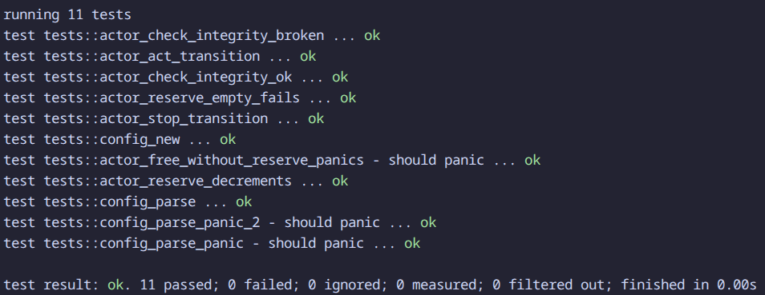
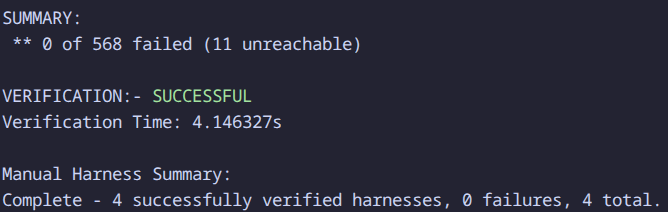
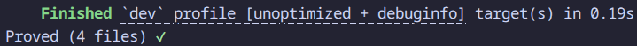

# Rust Verified Async Component
A program that simulates the behavior of a possible actor implemented in Rust.\
For the full verification strategy, tool-selection rationale, and comparative analysis, see the [Verification Report](REPORT.md).\
The actor is implemented as a small finite state machine (FSM); its behavior depends heavily on the state in order to avoid dangerous actions.\
It is also possible to simulate an example of how different amounts of actors will act on a given number of shared resources.\
All the configuration parameters are set by the arguments of the program. In particular:
- The first argument is the number of actors                                                            (default: 1)
- The second is the number of retries to access the shared resource an actor performs before failing    (default: 5)
- The third is the number of seconds the actor waits before retrying                                    (default: 1)
- The fourth is the number of shared resources                                                          (default: 1)
- The fifth is the amount of seconds the actor needs to perform its action                              (default: 3)

If any argument is missing, the default value is used.\
Some assumptions I made are that an actor whose integrity has been checked can't be compromised and that a broken actor cannot be repaired.\
## Building and running

### Multi-actor simulation (4 actors, 5 retries, 1s wait, 2 resources, 3s work):
```bash
cargo run -- 4 5 1 2 3
```
### Interactive single-actor mode (no arguments):
```bash
cargo run
```
### Native tests:
```bash
cargo test
```
### Kani verification:
```bash
cargo kani
```
### Creusot verification (from project root):
```bash
cargo creusot
```
## Main
The `main` function has two modes. If there are arguments when the program is launched it just takes the arguments used to launch the program, initializes the config and then calls the [`run`](#run) function. If there are no arguments it instead calls the [`direct_simulation`](#direct_simulation) function.
## Config
<a name="new"></a>
The `Config` struct, in the lib file, has five fields, one for each possible argument. The `new` function takes all five arguments and returns the correct `Config`.
### parse
The `parse` method takes a vector of Strings as argument, then initializes a vector with the default values.\
This last vector gets modified with the arguments taken as number and in the end it returns a new `Config` struct with the new values; if it's not possible or too many arguments are passed, the method returns an Err instead.
## run
The `run` function is the main example of how a chosen number of actors can act using a certain chosen number of shared resources.\
It generates the shared resources locked with a Mutex to avoid race conditions then it creates the async block and the vector that waits for the futures returned by the actors.\
It spawns the designated number of actors and for each of them adds the corresponding future to the vector. \
After the last actor is spawned it waits for each future and handles every error returned either printing the reason the actor did not act or by raising the same error again if the error is not recognized. Before returning it also asserts that the number of shared resources is the expected one.
## direct_simulation
The `direct_simulation` function allows the user to directly control an actor via the terminal, simulating its behaviour. It prints the current state of the actor and lets the user choose what to do next, reporting if the action is not allowed. The options are:
- 1 - let the user check the integrity of the actor and is required before making it act;
- 2 - makes the actor start its work;
- 3 - makes the actor stop;
- 4 - discard the new actor and create a new one (required if the actor is broken);
- 5 - make the program exit.

Any other input is ignored, prompting the user to try again.

## Actor
The struct that represents the actor, it has two fields: an `id` to identify the actor and a `_phantom` that contains its `PhantomData<S>`. It is generic over its current state: `Actor<S>` where `S` is one of [`Idle`](#idle), [`Initialized`](#initialized), [`Acting`](#acting), or [`Broken`](#broken). The state is enforced at the type level via `PhantomData<S>`: an actor can only call the methods defined for its current state, and each transition consumes `self` and returns a new `Actor<NextState>`. Invalid transitions are a compile error because the method simply does not exist on the wrong state.

### Idle
Represents an actor that has not been initialized yet. Its methods are:
- `new`, generates a new `Actor` with the `id` used as input and the initial `Idle` state.
- `check_integrity`, requires a bool (for example the `debug_check()` function that returns only true) and depending on what this value is it either returns the [`Initialized`](#initialized) state or the [`Broken`](#broken) state;
- `to_string`, returns a `String` with the actor's id and the state `"Idle"`;

### Initialized
Represents an actor that is initialized and is waiting for the instruction to act. Its methods are:
- `act`, returns the state [`Acting`](#acting);
- `to_string`, returns a `String` with the actor's id and the state `"Initialized"`;

### Acting 
Represents an actor while it's working. Its methods are:
- `stop`, returns the [`Initialized`](#initialized) state. The actor stops and waits to, eventually, start again.
- `to_string`, returns a `String` with the actor's id and the state `"Acting"`;

### Broken
Represents an actor that can't guarantee safety or has encountered an error while being initialized. It is a terminal state and its only method is:
- `to_string`, returns a `String` with the actor's id and the state `"Broken"`;

### Typestate invariants
The following invariants are enforced at compile time by the typestate pattern.

1. Integrity before action. `Actor<Idle>` has no `act()` method. The only valid path to [`Acting`](#acting) is [`Idle`](#idle) → `check_integrity` → [`Initialized`](#initialized) → `act` → [`Acting`](#acting). An uninitialised actor cannot start work.
2. [`Broken`](#broken) is terminal (by assumption). `Actor<Broken>` has no transition methods. Once broken, an actor is permanently disabled; there is no repair transition.
3. No double-start. `Actor<Acting>` has no `act()` method. An actor already working cannot be re-issued the act command.
4. No spurious stop. `Actor<Idle>` and `Actor<Initialized>` have no `stop()` method. Only an [`Acting`](#acting) actor can be stopped.
5. Integrity is stable (by assumption). `Actor<Initialized>` and `Actor<Acting>` have no `check_integrity()` method. Once verified, the actor's integrity is not re-checked.

The typestate pattern makes invalid transitions unrepresentable. For example, the following code **does not compile**:

```rust
let actor = Actor::<Idle>::new("x".to_string());
let _ = actor.act(); // error[E0599]: no method named `act` found for type `Actor<Idle>`
```


### reserve_resource
It takes as input the `shared_resource` Mutex and waits to access it. Then if there are still resources available it reserves one and frees the Mutex for the other `Actor`s returning true. If no resources are still available it still frees the Mutex but it returns false.
> [!CAUTION]
> It is very important that after the resource is reserved it gets freed after the actor stops, otherwise the other actors can't access it even if no actor is working.
### free_resource
It works in a similar way to the [`reserve_resource`](#reserve_resource) method. It takes the `shared_resource` Mutex as input and tries to access it. Then it frees a resource for other `Actor`s. It also asserts that the counter is below the configured capacity before incrementing, preventing a double-free from exceeding the limit.
### run_one
Simulates a possible complete execution of an `Actor`.\
At first the `Actor` checks its integrity, then it tries to reserve a resource.\
If it can, it simulates the act by sleeping for the [`Config`](#config)'s duration (in the mean time other `Actor`s can perform whichever action they can since the simulation is asynchronous). After this time the `Actor` is stopped, the resource is freed and the duration for which the `Actor` has worked is printed; `Ok` is returned.\
If the resource is busy, the process waits for the duration specified in the [`Config`](#config) struct and retries as many times as specified in the [`Config`s](#config). If it still could not act then a special error is raised.

## Tests
All the tests I made for the functions and to verify that everything works as it should.

### Rust-native tests
These are the tests natively supported in Rust framework.\
They check that the [`Config`](#config) methods, the [`Actor`](#actor) state transitions, and the resource functions work as intended. To be specific:
- The first test checks if the [`new`](#new) method returns what I expect;
- The second test checks if the same thing applies for the [`parse`](#parse) method;
- The third and fourth tests check if the [`parse`](#parse) method panics when it should;
- There is a test also for every possible state transition so that they all work as expected;
- The last tests check if the resource freeing and locking works correctly and panics when they should.

These tests result in:\
\

### Kani
[[Kani](https://github.com/model-checking/kani) 0.67.0]\
Kani helps test different values to verify that no unsafe condition can be met focusing, for example, on overflow or array bounds.\
In my case I did four different tests, two on the [`parse`](#parse) method of the [`Config`](#config) struct, the others on the [`reserve_resource`](#reserve_resource) and [`free_resource`](#free_resource) functions:
- The first test verifies that any `String` value that can be parsed as an unsigned number causes no panic and gets correctly parsed by the method;
- The second test verifies that any `String` value that ***cannot*** be parsed as an unsigned number causes a panic;
- The third test checks if for any capacity a free after a reserve correclty frees the resource;
- The fourth test checks if the function correctly panics if a double_free is executed.

These tests result in:\
\

### Creusot
[[Creusot](https://creusot.rs/) 0.14.0-dev]\
Creusot is a tool that verifies Rust functions against formal contracts (pre- and post-conditions), proving they hold for all inputs.\
In this project I used Creusot to verify the [`new`](#new) method of the [`Config`](#config) struct so that all the outputs correspond exactly to what is expected.\
I cannot check the [`parse`](#parse) method since Creusot does not support std::parse() correctly so it is just marked as `#[trusted]`.
This verification passes:\
\

